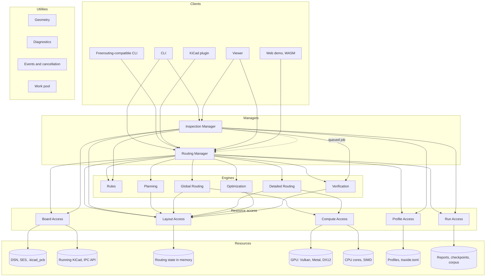

# Architecture

traxide is decomposed by volatility, following the iDesign Method: each component hides one thing that is likely to change ([Volatilities](Architecture/Volatilities.md)), calls only go down, and the core use cases are carried out by composing the same few components ([Use cases](Architecture/Use-cases.md)).

[TOC]

## Static architecture

Utilities are usable by every layer and are left out of the arrows.

## Components

### Clients

Clients hide **how the router is invoked** (V1). Each turns its input into a job for a manager and presents the events the manager publishes. A client never routes, never reads a board file and never calls two managers for one use case.

| Client | Purpose |
| --- | --- |
| `traxide` CLI | `route`, `optimize`, `check`, `bench`: the primary interface, scriptable in CI |
| Freerouting-compatible CLI | Accepts Freerouting's flags (`-de board.dsn -do board.ses -mp 20 …`), so tools that call Freerouting, including KiCad's Freerouting plugin, can call traxide instead |
| KiCad plugin | A KiCad Plugin and Content Manager package: a button in the PCB editor that routes the open board through the IPC API, with progress and undo |
| Viewer | A window that draws the board and the routing as it happens, for debugging the engines and for demos |
| Web demo | The managers compiled to WebAssembly, on CPU or WebGPU, in a browser tab |

### Managers

Managers hide **volatility in sequence**: the workflow of a use case. There are two, and each runs a family of related use cases.

| Manager | Use cases | Hides |
| --- | --- | --- |
| Routing Manager | Route a board; route selected or unrouted nets around locked copper; optimise existing routing; resume a checkpointed job | V2: which stages run, in which order, when to stop, how a profile chooses between speed and quality |
| Inspection Manager | Check a board (DRC and metrics); compare two results; run the benchmark corpus | V3: which checks and metrics, baselines, how comparisons are scored |

The Inspection Manager reaches the Routing Manager only through a queued job (the benchmark), never by a direct call: managers stay independent.

### Engines

Engines hide **volatility in activity**: the algorithms. They are pure computations over data contracts; they never call each other. When one engine's result feeds another, the manager passes it along, as data.

| Engine | Does | Hides |
| --- | --- | --- |
| Rules | Compiles the design's rules into a *constraint set*: dense lookup tables (clearance by net class pair and layer, widths, via stacks, pairs, length groups) that the other engines query in O(1) | V4 |
| Planning | Decomposes nets into connections (MST/Steiner), orders them, plans fanouts and escapes, partitions the board into batches that workers can route in parallel | V5 |
| Global Routing | Routes every connection on a coarse 3D grid with negotiated congestion, giving each a corridor and a layer assignment | V6 |
| Detailed Routing | Turns corridors into exact, rule-correct tracks and vias: shape-based A* inside the corridor, rip-up and reroute, push and shove | V7 |
| Optimization | Pull-tight, via removal, 45° and arc smoothing, length tuning, teardrops | V8 |
| Verification | An independent DRC and quality metrics: completion, length, vias, violations. It reads the same constraint set, so the rules have one interpretation, but shares no clearance code with the routing engines | V9 |

The [Routing pipeline](Architecture/Routing-pipeline.md) explains the algorithms and why they were chosen.

### Resource access

Resource access components hide **how resources are reached** and expose atomic, business-level verbs, not CRUD.

| Component | Verbs (examples) | Hides |
| --- | --- | --- |
| Board Access | `load_design`, `store_routes`, `lock_board` | V10: Specctra DSN/SES, `.kicad_pcb` with its project files, the KiCad IPC API (on KiCad 10 combined with rules read from the project files), later formats; their versions and quirks |
| Layout Access | `build_layout`, `obstacles_near`, `clearance_violations`, `begin`/`commit` a transaction, `rip_up`, `snapshot` | V11: the spatial index, the memory layout, optimistic concurrency between workers |
| Compute Access | `expand_wavefronts`, `update_congestion`, `route_batch` on a cost grid | V12: GPU (wgpu over Vulkan, Metal, DirectX 12) or CPU (threads and SIMD), device choice, buffers, fallback |
| Profile Access | `load_profile` | V13: built-in profiles, `traxide.toml`, flags, KiCad project settings |
| Run Access | `record_run`, `store_checkpoint`, `load_corpus`, `baseline_of` | V14: where reports, checkpoints, the corpus and baselines live |

### Utilities

Cross-cutting infrastructure that passes the method's "could any system use it?" test:

| Utility | Holds |
| --- | --- |
| Geometry | Integer nanometre points and vectors, robust predicates, segment and arc distances, polygon offset and Minkowski sums, octilinear helpers |
| Diagnostics | Structured logs, spans, counters and timings (`tracing`) |
| Events and cancellation | Progress events published to clients, cancellation tokens, the in-process job queue between managers |
| Work pool | The thread pool and deterministic parallel reductions |

## Rules between components

| Component | May call | Never calls |
| --- | --- | --- |
| Client | Managers (one per use case) | Engines, resource access |
| Manager | Engines, resource access; another manager only through a queued job | Clients |
| Engine | Resource access (Layout, Compute) | Other engines, managers |
| Resource access | Resources | Other resource access, engines, managers |
| Any | Utilities, contracts | — |

The rules are enforced at compile time: every component is a crate of a Cargo workspace, and a crate can only use the crates it declares. A check in CI (`cargo xtask layers`) fails when a crate declares a dependency the table forbids. See [Development](Development.md).

## Performance within the boundaries

Service boundaries cost nothing at run time. Components talk through Rust traits that are generic, not `dyn`: an engine is written against `L: LayoutAccess` and `C: ComputeAccess`, and the manager that composes them picks the concrete types, so the compiler monomorphises and inlines across the boundary. Hot loops such as clearance queries run without virtual calls or allocation. `dyn` is used only at the edges, where a client picks a board format or a compute device at run time.

[SUBPAGES]
