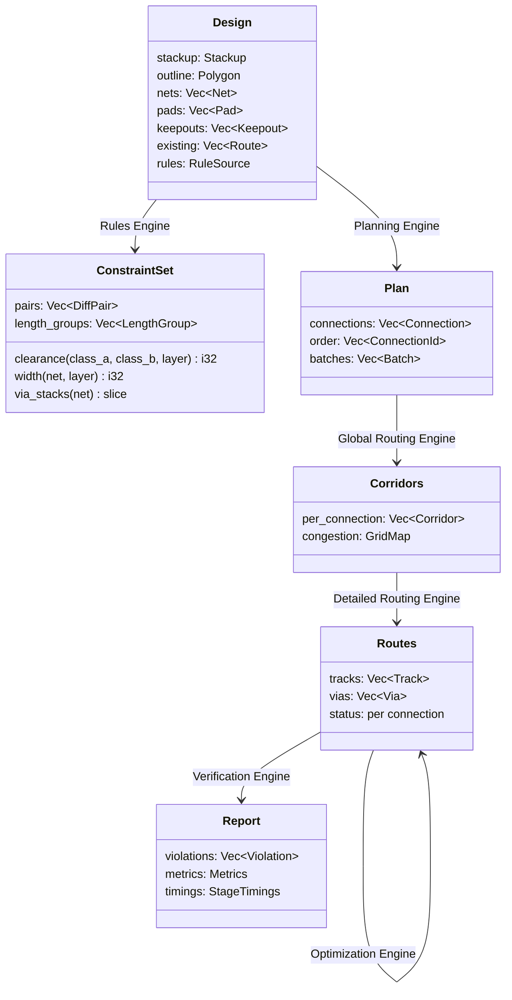

# Contracts

The `contracts` crate holds what every component agrees on: the data that flows between them and the traits each component implements. It hides nothing and depends on nothing but the Geometry utility.

[TOC]

## Units and geometry

- Coordinates are `i32` nanometres, as in KiCad: exact, deterministic and compact (a point is 8 bytes, so a cache line holds 8). Boards are limited to ±1 m, so differences fit in 31 bits and cross products are exact in `i64`; `i128` is used where three products meet (intersection points).
- Angles of tracks are octilinear (0°, 45°, 90°…) by default; arcs are kept as arcs, never polylines.
- Layers are indices into the stackup, `u8`. A board has at most 64 copper layers.
- Identifiers (`NetId`, `PadId`, `LayerId`, `RouteId`) are dense indices into the design's arrays, never strings or pointers. Names live in side tables for reporting.

## Data contracts



| Contract | Produced by | Consumed by |
| --- | --- | --- |
| `Design` | Board Access | Rules, Planning, Layout Access, Verification |
| `ConstraintSet` | Rules Engine | Layout Access and every routing engine |
| `Plan` | Planning Engine | Global and Detailed Routing |
| `Corridors` | Global Routing Engine | Detailed Routing |
| `Routes` | Detailed Routing, Optimization; Board Access for existing copper | Optimization, Verification, Board Access |
| `Report` | Verification Engine, managers (timings) | Run Access, clients |
| `Job`, `Profile` | Clients, Profile Access | Managers |
| `Event` | Managers | Clients (progress, congestion maps, committed batches, finished) |

`Design` is format-neutral. Whatever a DSN file, a `.kicad_pcb` or the KiCad IPC API calls things, Board Access translates them into it. Rules arrive in `Design.rules` as a `RuleSource` close to their origin; only the Rules Engine interprets them.

## Service contracts

Engines reach resource access only through traits in `traxide-contracts`; the manager picks the implementation and the compiler monomorphises the call (see [Architecture](../Architecture.md#performance-within-the-boundaries)). Where only one implementation exists and only managers call it, a component exposes plain functions instead of a trait (YAGNI): Board Access's `load_design` and `store_routes`, Profile Access's `load_profile`, the engines' `compile`, `plan` and `verify`.

The routing state, as built:

![[crates/contracts/src/layout.rs#L4-L17]]

Transactions for parallel workers (`begin`, `commit`) join this trait with [[TRX-27]].

## For tests

With the `testing` feature, `traxide_contracts::testing` builds designs in a few lines, in millimetres:

```rust
let design = DesignBuilder::new(20.0, 10.0)
    .smd("A1", Some("A"), at(5.0, 5.0), 1.0, 0)
    .tht("J1-1", Some("A"), at(15.0, 5.0), 1.7)
    .build();
```

Only test code enables the feature; release builds never contain it.
