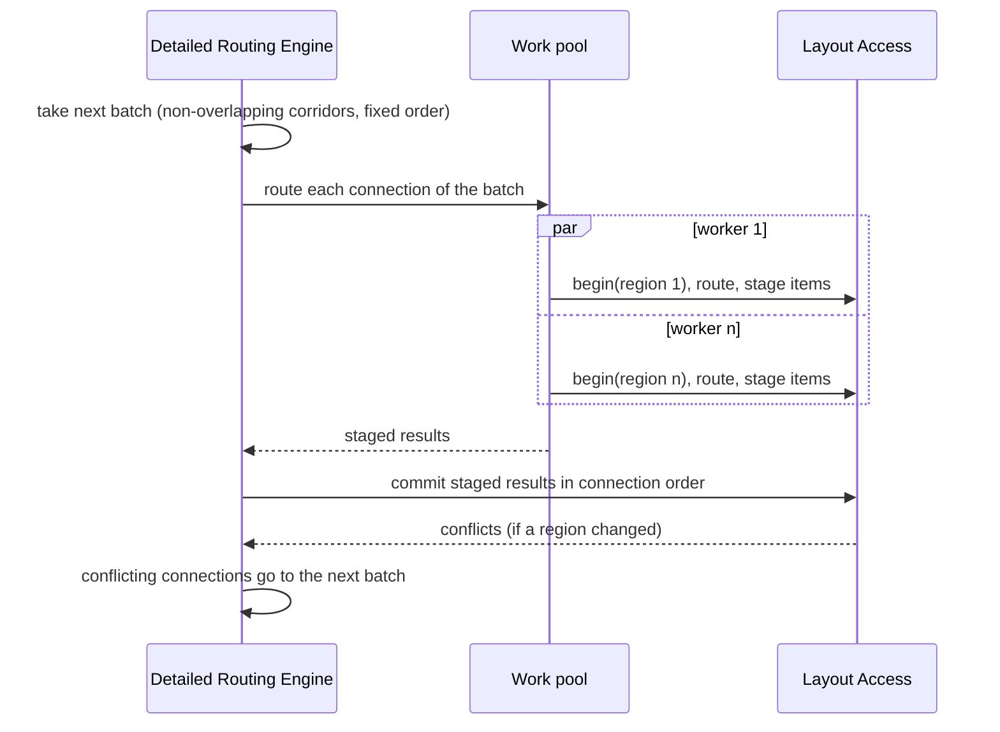

# Parallelism and GPU

How fastrouting uses 24 cores and a GPU without giving up deterministic results, and where each kind of parallelism lives in the [Architecture](../Architecture.md).

[TOC]

## Principles

1. **Parallelise across nets and regions, not inside one search.** A keyboard's connections are short; one A* takes microseconds. Thousands of them side by side fill every core.
2. **Deterministic by construction.** The same design and profile give the same routes on 1 or 24 threads, on CPU or GPU. Parallelism changes *when* work happens, never *what* is committed.
3. **The GPU is an accelerator, never a requirement.** Every GPU kernel has a CPU twin that is the reference in tests and the fallback at run time.
4. **Parallelism is hidden where its volatility is.** Engines decide *what* may run in parallel (batches); the Work pool runs it; Compute Access decides *where* data-parallel kernels run; Layout Access decides *how* concurrent commits are reconciled.

## Where it happens

| Stage | Unit of parallel work | Mechanism | Device |
| --- | --- | --- | --- |
| Build layout | Layer | Work pool | CPU |
| Plan | Net | Work pool | CPU |
| Global: pattern routing | Connection | Compute Access kernel | CPU SIMD or GPU |
| Global: congestion and history costs | Grid edge | Compute Access kernel | CPU SIMD or GPU |
| Global: negotiation | Batch of non-overlapping connections | Compute Access (`route_batch`) | CPU threads; GPU for large grids |
| Detailed routing | Batch of non-overlapping corridors | Work pool + Layout Access transactions | CPU threads |
| Repair | Window | Work pool | CPU |
| Optimise | Region | Work pool + copy-on-write snapshots | CPU |
| Verify | Tile | Work pool, SIMD distance checks | CPU; GPU possible for huge boards |

## Batches and transactions

- Batches come from a deterministic greedy colouring of regions: the **Planning Engine** colours inflated bounding boxes for global routing; the **Detailed Routing Engine** colours corridors once global routing has fixed them.
- Workers read a consistent view and **stage** their items; they don't write.
- The engine **commits in connection order**, not completion order. Layout Access checks each commit against what was committed before it in the same batch (optimistic concurrency: versions per spatial bucket). Conflicts are rare by construction and go to the next batch.
- Ties in every priority queue break on (cost, connection id, position), never on memory addresses or hash order. Random choices use a seeded generator per connection.

That makes the result a function of the input alone. Tests route every corpus board with 1, 4 and all threads and require identical output ([[FR-27]]).

## Global routing on CPU and GPU

Negotiated congestion is the classic parallel shape: in each iteration, every connection of a batch routes against the same congestion map, then the costs of every grid edge are updated at once.

| Kernel | Work | CPU twin | GPU |
| --- | --- | --- | --- |
| `pattern_route` | L/Z/3-bend candidates per connection, layer DP | rayon over connections, SIMD over candidates | One workgroup per connection |
| `update_congestion` | Present and history costs per edge | SIMD loop over SoA arrays | One invocation per edge |
| `expand_wavefronts` | Bounded multi-source search for a batch | A* per connection on threads | Sweep-based (GAMER-style) or frontier per dispatch |
| `rasterise_obstacles` | Capacities of the coarse grid | Threads by layer | One invocation per cell |

GPU constraints are designed in: costs and tie-breaks packed into 32-bit `atomicMin` (no portable 64-bit atomics), one dispatch per frontier level or a persistent loop with a convergence flag, adapter limits read at run time. Compute Access picks the device (`--gpu auto|on|off`); `auto` uses the GPU only above a size threshold where the benchmark shows it wins.

## What stays on the CPU

Detailed routing, push and shove and optimisation are branchy, geometric and irregular in memory: a poor fit for GPUs. They run on CPU threads, with SIMD in the hot clearance checks (segment–segment distances against inflated obstacles of a bucket, 8 at a time).

## Memory layout

- Structures of arrays for everything in hot loops: obstacle coordinates, grid capacities and costs.
- Typed indices instead of pointers; per-search scratch in a bump arena reset after each connection; no allocation in the inner loop.
- Uniform grid buckets sized to the typical clearance-inflated track (a few hundred µm), so a clearance query touches a handful of buckets.
