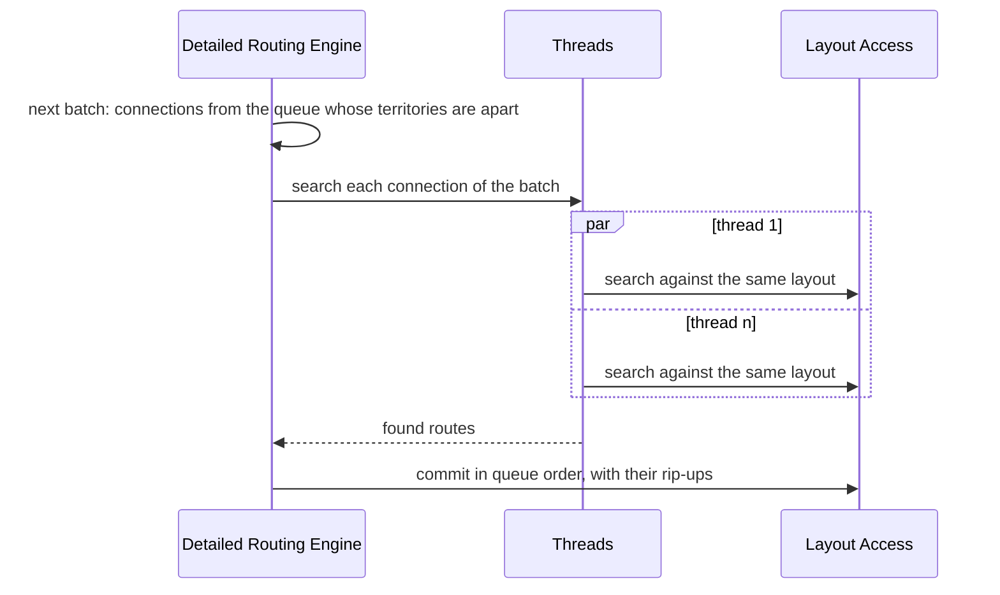

# Parallelism and GPU

How traxide uses 24 cores and a GPU without giving up deterministic results, and where each kind of parallelism lives in the [Architecture](../Architecture.md).

[TOC]

## Principles

1. **Parallelise across nets and regions, not inside one search.** Most of a keyboard's connections are short; one A* takes microseconds, and many of them side by side fill every core. The few long ones, which overlap everything, are where the time actually goes ([see Batches](#batches)).
2. **Deterministic by construction.** The same design and profile give the same routes on 1 or 24 threads, on CPU or GPU. Parallelism changes *when* work happens, never *what* is committed.
3. **The GPU is an accelerator, never a requirement.** Every GPU kernel has a CPU twin that is the reference in tests and the fallback at run time.
4. **Parallelism is hidden where its volatility is.** Engines decide *what* may run in parallel (batches); the Work pool runs it; Compute Access decides *where* data-parallel kernels run; Layout Access decides *how* concurrent commits are reconciled.

## Where it happens

| Stage | Unit of parallel work | Mechanism | Device |
| --- | --- | --- | --- |
| Build layout | Layer | Work pool | CPU |
| Plan | Net | Work pool | CPU |
| Global: pattern routing | Connection | Compute Access kernel | CPU SIMD or GPU |
| Global: congestion and history costs | Grid edge | Compute Access kernel | CPU SIMD or GPU |
| Global: negotiation | Batch of non-overlapping connections | Compute Access (`route_batch`) | CPU threads; GPU for large grids |
| Detailed routing | Batch of connections with apart territories | Scoped threads, commits in queue order | CPU threads |
| Repair | Window | Work pool | CPU |
| Optimise | Region | Work pool + copy-on-write snapshots | CPU |
| Verify | Tile | Work pool, SIMD distance checks | CPU; GPU possible for huge boards |

## Batches

Built for detailed routing in [[TRX-27]]:

- A connection's **territory** is its search window grown by the reach of its copper (half its track width or its via radius) and the largest clearance. Two connections whose territories are apart cannot meet, so a batch needs no transactions and has no conflicts to resolve: a debug assertion checks it.
- A batch takes connections from the front of the queue, in order, up to the profile's `batch_size` ([[Profiles]]). A connection joins only if its territory overlaps neither those taken nor those skipped before it, so it never overtakes a connection it could meet. The scan looks at most at four connections per slot, which keeps it cheap on boards with many connections.
- Threads read the layout and the rip-up counts as they were when the batch started, and **stage** their routes; the engine commits them in queue order, never in the order threads finish.
- Ties in every priority queue break on (cost, slot), never on memory addresses or hash order.

That makes the result a function of the input and the profile alone. Tests route a scattered board on 1, 2 and 4 threads, and the CLI writes byte-identical sessions for KiCad's matrix-3x4 on 1, 4 and 16 threads; on keyboard-tkl and matrix-6x17 the sessions are identical for every thread count, and identical to routing one connection at a time.

> [!NOTE]
> **Measured: batches don't speed up the keyboards.** Their time goes to a few long connections from the MCU or header across the board. Those overlap everything, so they run one at a time, and the short connections that do run side by side took under a second anyway ([[Benchmarks#parallel-batches-m2-trx-27]]). Speed on such boards has to come from cheaper long searches ([[TRX-24]], [[TRX-48]]). Batches will pay off on boards with many short, spread-out connections.

**Memory per thread.** Each thread keeps its own search memory. Dense arrays over a long connection's whole window (every node, layer and heading) took over a gigabyte per thread, and filling fresh memory for each thread cost more than the threads saved. The arrays are now tiled: a search maps a tile of 1024 entries on its first write to it, so memory follows the states a search touches, about a quarter of the window on the worst search and under 2 % on most. The largest search of a batch runs on the calling thread, whose memory the batches of one connection have already grown.

## Global routing on CPU and GPU

Negotiated congestion is the classic parallel shape: in each iteration, every connection of a batch routes against the same congestion map, then the costs of every grid edge are updated at once.

| Kernel | Work | CPU twin | GPU |
| --- | --- | --- | --- |
| `pattern_route` | L/Z/3-bend candidates per connection, layer DP | rayon over connections, SIMD over candidates | One workgroup per connection |
| `update_congestion` | Present and history costs per edge | SIMD loop over SoA arrays | One invocation per edge |
| `expand_wavefronts` | Bounded multi-source search for a batch | A* per connection on threads | Sweep-based (GAMER-style) or frontier per dispatch |
| `rasterise_obstacles` | Capacities of the coarse grid | Threads by layer | One invocation per cell |

GPU constraints are designed in: costs and tie-breaks packed into 32-bit `atomicMin` (no portable 64-bit atomics), one dispatch per frontier level or a persistent loop with a convergence flag, adapter limits read at run time. Compute Access picks the device (`--gpu auto|on|off`); `auto` uses the GPU only above a size threshold where the benchmark shows it wins.

## What stays on the CPU

Detailed routing, push and shove and optimisation are branchy, geometric and irregular in memory: a poor fit for GPUs. They run on CPU threads, with SIMD in the hot clearance checks (segment–segment distances against inflated obstacles of a bucket, 8 at a time).

## Memory layout

- Structures of arrays for everything in hot loops: obstacle coordinates, grid capacities and costs.
- Typed indices instead of pointers; per-search scratch in stamped tiles, forgotten in O(1) after each connection; no allocation in the inner loop once the tiles are there.
- Uniform grid buckets sized to the typical clearance-inflated track (a few hundred µm), so a clearance query touches a handful of buckets.
