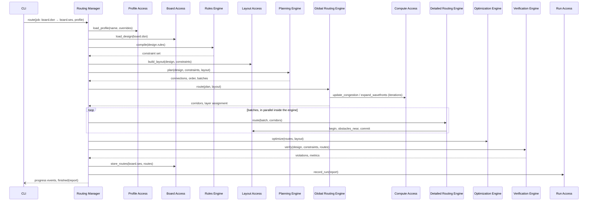
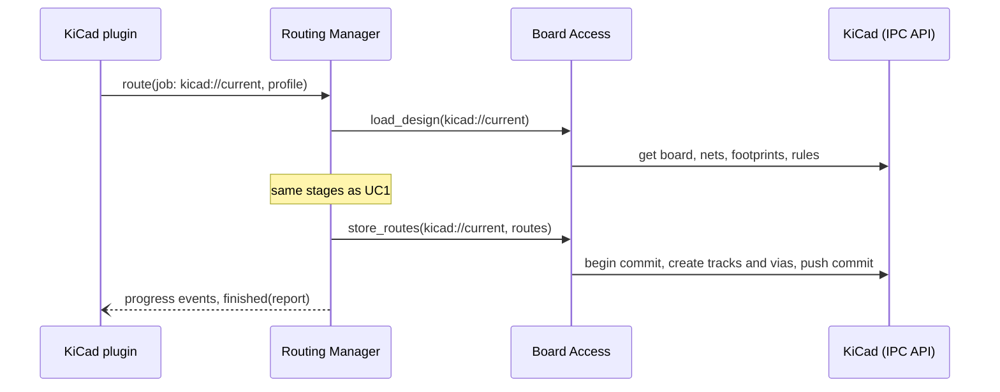
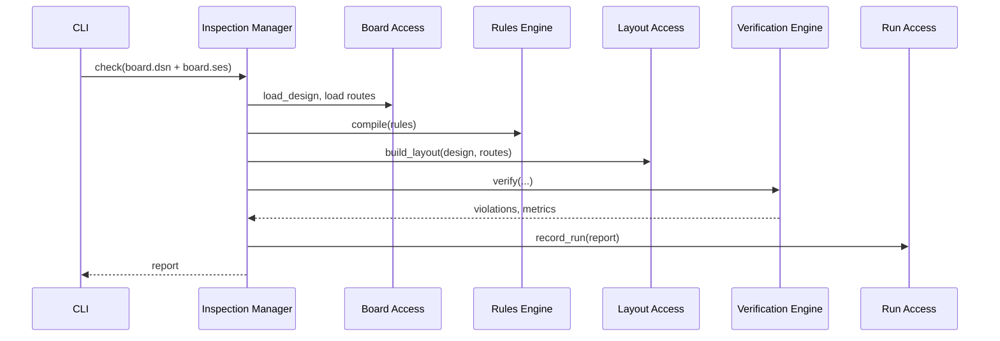
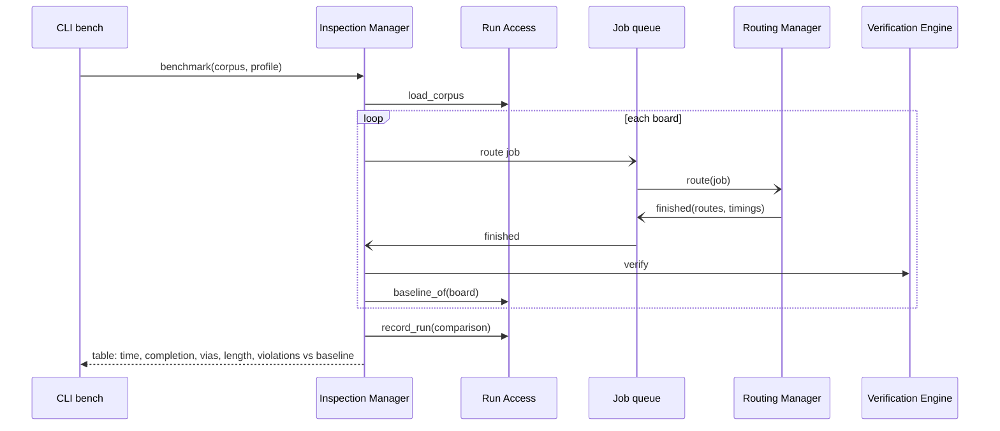

# Use cases

The iDesign Method validates an architecture by showing that the core use cases are carried out by the same components, interacting differently, rather than by components built for each use case. These are traxide's core use cases and their call chains. Solid arrows are synchronous calls, dashed arrows events or queued calls.

[TOC]

## Core use cases

| # | Use case | Client | Manager |
| --- | --- | --- | --- |
| UC1 | Route a board from a Specctra DSN file to a SES file | CLI, Freerouting-compatible CLI | Routing |
| UC2 | Route the board open in KiCad and write the tracks back, undoable | KiCad plugin | Routing |
| UC3 | Route only selected or unrouted nets, keeping locked copper | CLI, KiCad plugin | Routing |
| UC4 | Optimise an existing routing | CLI, KiCad plugin | Routing |
| UC5 | Check a board: DRC and quality metrics | CLI | Inspection |
| UC6 | Run the benchmark corpus and compare with baselines | CLI (`bench`), CI | Inspection, which queues jobs for Routing |
| UC7 | Watch a routing job live | Viewer | Routing |

## UC1: Route a board from DSN to SES

The use case every other one varies.

The manager decides the stages and their order from the profile: a *fast* profile skips optimisation and stops detailed routing after a time budget; a *quality* profile adds more rip-up iterations and every optimisation pass.

## UC2: Route the board open in KiCad

Identical to UC1 except for the client and for what Board Access talks to: the IPC API of the running KiCad instead of files. Board Access reads the board, the net classes and the custom rules from KiCad, and writes all tracks and vias in one commit, so a single undo removes them.

Nothing above Board Access knows KiCad is involved. Supporting another EDA tool is a new adapter inside Board Access.

## UC3: Route selected or unrouted nets

The job names the nets to route and marks the rest as locked. Board Access loads existing copper as locked routes; Layout Access treats them as obstacles; Planning plans only the requested nets. The same engines run; the manager's workflow differs only in its inputs.

## UC4: Optimise an existing routing

The Routing Manager skips planning, global and detailed routing: load, compile rules, build the layout from the existing routes, optimise, verify, store. Verification guards the optimiser: if a pass would add a violation, the manager keeps the previous routes.

## UC5: Check a board

Running the same Verification Engine on Freerouting's output and on ours is what makes the benchmark fair.

## UC6: Run the benchmark corpus

The managers never call each other directly: the queue (from the Events utility) decouples them, which also lets the benchmark run boards concurrently.

## UC7: Watch a routing job live

The viewer starts a route job like the CLI does and subscribes to its events. The Routing Manager publishes stage changes, congestion maps after each global iteration and every committed batch. The viewer draws them; it never reads the layout itself. A cancel button cancels the job's token; the manager stops at the next batch boundary, stores a checkpoint through Run Access, and the job can be resumed (UC1 with `resume`).
