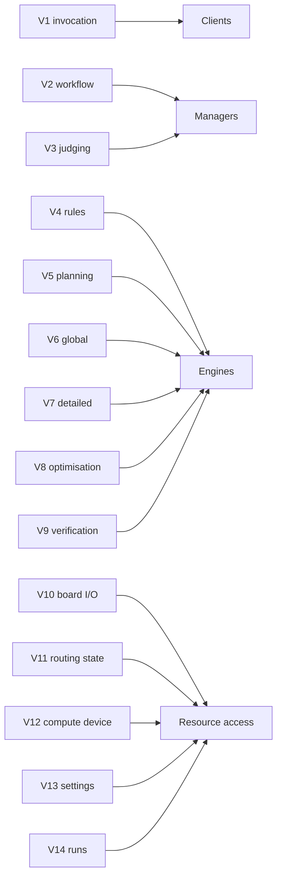

# Volatilities

traxide is decomposed by volatility, following the iDesign Method (Juval Löwy, *Righting Software*): every component encapsulates one thing that is likely to change, so that change stays inside it. This page lists what we expect to change, along the two axes the method asks about, and where each volatility is encapsulated. [Architecture](../Architecture.md) shows the resulting components.

[TOC]

## The two axes

- **Over time, for the same user**: what a keyboard designer needs from traxide next year that they don't need today — new constraint kinds, a new KiCad version, a better algorithm, a GPU they just bought.
- **Across users, at the same time**: what differs between two people routing today — KiCad on Windows versus a CI job on Linux, a 2-layer macropad versus an 8-layer BGA board, a laptop without a GPU versus a desktop with one, "route it in 5 seconds" versus "route it as well as you can".

Anything that varies along either axis is a candidate. A candidate becomes a component only when it is a real volatility (it changes the system's behaviour or structure, and is expensive to change if spread out), not a mere *variability* that a parameter covers.

## Volatilities and where they live

| # | Volatility | Axis | Encapsulated in |
| --- | --- | --- | --- |
| V1 | **How the router is invoked**: a CLI, a drop-in for the Freerouting command line, a KiCad plugin, a live viewer, a browser (WASM), an HTTP service | Users, time | Clients |
| V2 | **The routing workflow**: which stages run, in which order, with what stop criteria — a full autoroute, routing only the selected or the unrouted nets around locked tracks, only optimising, a fast preview versus a quality run, resuming a job | Users, time | Routing Manager |
| V3 | **How results are judged**: which checks, which metrics, which baselines, how runs are compared (to Freerouting, to the previous release) | Time | Inspection Manager |
| V4 | **The design rules and their semantics**: clearances per net class and layer, track widths, via types (through, blind, buried, micro), keepouts, differential pairs, length groups, KiCad custom rules (`.kicad_dru`), new constraint kinds | Time, users | Rules Engine |
| V5 | **How the work is planned**: net topology (MST, Steiner), net ordering, escape/fanout plans, how the board is partitioned into independent batches for parallel workers | Time | Planning Engine |
| V6 | **The global routing algorithm**: negotiated congestion on a coarse 3D grid today; ILP, learned congestion prediction or something better tomorrow | Time | Global Routing Engine |
| V7 | **The detailed routing algorithm**: shape-based A*, rip-up and reroute, push and shove, any-angle versus octilinear geometry | Time | Detailed Routing Engine |
| V8 | **The post-processing passes**: pull-tight, via removal, 45° and arc smoothing, length tuning meanders, teardrops | Time, users | Optimization Engine |
| V9 | **How correctness is verified**: an independent DRC that never shares code paths with the router, plus quality metrics | Time | Verification Engine |
| V10 | **Where the board comes from and where the result goes**: Specctra DSN/SES files, `.kicad_pcb`, the KiCad IPC API of a running KiCad, later tscircuit JSON, IPC-2581, other EDA tools; and their versions | Users, time | Board Access |
| V11 | **How the routing state is stored and queried**: the spatial index (uniform grid, R-tree, BVH), memory layout, how parallel workers commit without locking each other out, snapshots for rip-up and checkpoints | Time | Layout Access |
| V12 | **Where data-parallel work runs**: a GPU through Vulkan, Metal or DirectX 12, CPU threads with SIMD, a single thread in a browser; device selection, buffers and fallback | Users, time | Compute Access |
| V13 | **Where settings come from**: built-in profiles, a `traxide.toml`, command line flags, KiCad project settings | Users | Profile Access |
| V14 | **Where runs are kept**: reports, checkpoints, the benchmark corpus and its baselines | Time | Run Access |

## Not volatilities

The method warns against encapsulating the *nature of the business*, which does not change, and against speculative volatility that nobody will pay for. For traxide these stay out of the decomposition:

- **What a board is.** Layers, pads, nets, keepouts, tracks and vias have been the same for decades; the [data contracts](Contracts.md) model them directly.
- **What routing is.** Connect every net's pins on copper without breaking a rule, minimising length and vias. The core use case is stable; only how it is done changes.
- **Integer nanometre coordinates.** As in KiCad, every coordinate is an `i32` of nanometres, with exact `i64` products (see [Contracts](Contracts.md#units-and-geometry)). Exact, deterministic, SIMD-friendly. Not a volatility.
- **IC (VLSI) routing, autoplacement, signal integrity simulation.** Different products. Out of scope until someone asks.

## Variabilities, not components

These vary, but a parameter of an existing component covers them; they never become components of their own:

- Cost weights (via cost, layer preference, wrong-way penalty), iteration limits, thread count, grid pitch: fields of a profile.
- Output detail (SES only, or a report too): options of the client.
- Determinism: always on. The same input and profile give the same result on 1 or 24 threads (see [Parallelism and GPU](Parallelism-and-GPU.md)).

## How the volatilities map to layers

Managers encapsulate volatility in **sequence** (the use cases), engines volatility in **activity** (the algorithms), resource access volatility in **how resources are reached**. See [Architecture](../Architecture.md) for the components and the rules between them.
