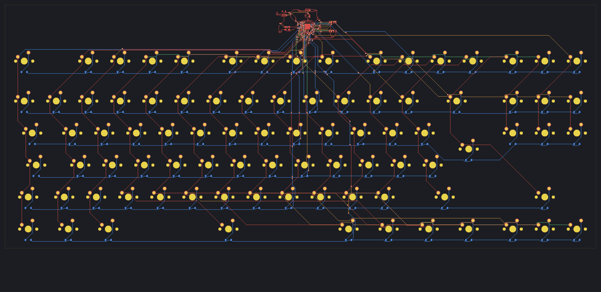
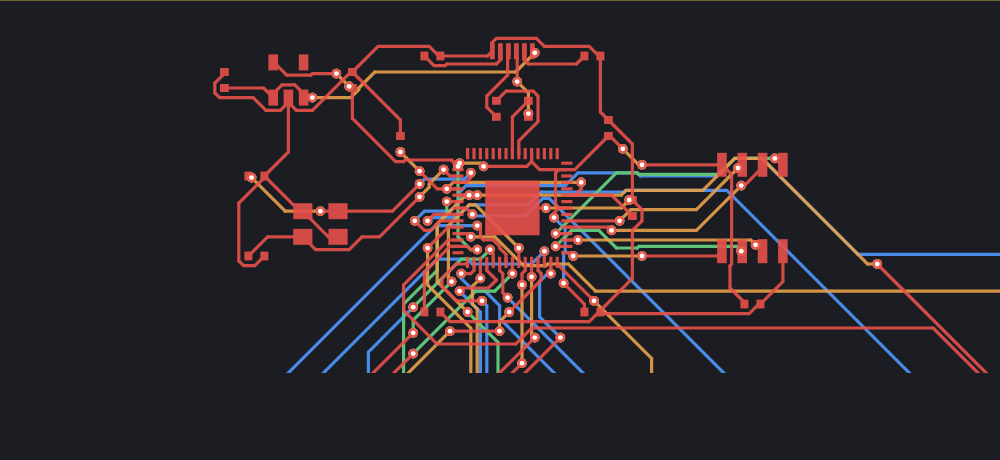
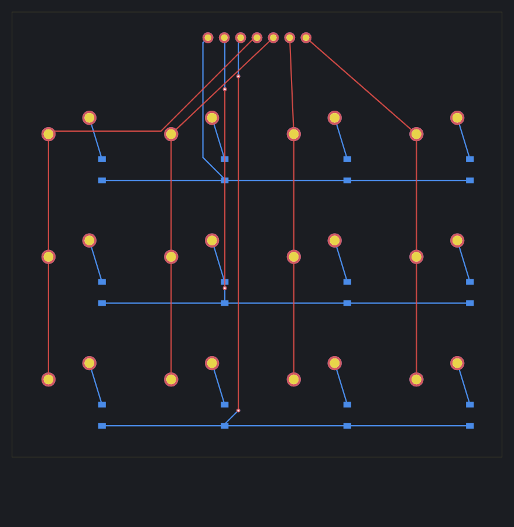

# Benchmarks

Measurements of traxide on the end-to-end boards, newest first; the comparison with Freerouting runs in CI, the rest by hand until the benchmark gate of [[TRX-22]]. Every board traxide routed below was imported into KiCad 10.0.7 and passed its DRC with no violations.

[TOC]

## How to measure

```bash
cargo xtask e2e placements crossing matrix-3x4 matrix-6x17   # builds, routes and checks the recipes
time target/release/traxide route -q target/e2e/matrix-6x17/matrix-6x17.dsn
```

The machine: a 4-core cloud container (x86-64), one thread used.

## traxide against Freerouting 2.5.0

October 2026, `cargo xtask bench` in the Benchmark workflow on a GitHub Actions runner (ubuntu-latest, 4 vCPUs): both routers get the same DSN exported by KiCad 10, KiCad 10 imports each session, and KiCad's own DRC judges both. Freerouting ran with its defaults (`-de board.dsn -do board.ses --gui.enabled=false`); traxide with its default profile. Two runs on different days' runners:

| Board | Router | Time | Unconnected | Violations | Tracks | Vias | Track length |
| --- | --- | ---: | ---: | ---: | ---: | ---: | ---: |
| matrix-6x17 | **traxide** | **1.4 s / 1.0 s** | 0 | **0** | 547 | **23** | **5947 mm** |
| matrix-6x17 | Freerouting | 54.4 s / 90.0 s | 0 | 30 / 18 | 852 / 831 | 40 / 36 | 6605 / 6662 mm |
| keyboard-tkl | **traxide** | **9.8 s / 7.2 s** | 0 | **0** | 1552 / 1550 | **108** | **8304 mm** |
| keyboard-tkl | Freerouting | 266.2 s / 480.9 s | 0 | 199 / 199 | 1645 / 1577 | 225 / 230 | 8548 / 8574 mm |

traxide is 39–90 times faster on the matrix and 27–67 times on the keyboard, with about half the vias and less track, and its boards are the ones KiCad finds clean. traxide's routes are the same in every run; Freerouting's differ from run to run.

**What Freerouting's violations are.** In the second run KiCad listed them by kind: all 18 on the matrix and all 199 on the keyboard are `track_width`, with no clearance violation and nothing unconnected. They are tracks narrower than 0.2 mm, the minimum track width of KiCad 10's default board setup, which the recipes keep, and the width the DSN asks for. So they come from Freerouting's own choice of narrower tracks, not from a rule the DSN leaves out; the KiCad edge clearance that tripped traxide early on ([[Research/KiCad-integration#rules-the-dsn-leaves-out]]) did not trip Freerouting here. The Benchmark workflow now keeps the sessions, DRC reports and routed boards as an artifact, to show where those tracks are.

## Each state expanded once (M2, TRX-49)

October 2026: a weighted search reaches many states first by a worse way round, and expanded them again for every better way: the keyboard's longest search expanded 3.7 million times, but only 590 000 distinct states. Now each state is expanded once, which keeps the path within the weight of the cheapest. Measured in the 4-core container, every board clean in KiCad 10's DRC with nothing unconnected:

| Board | Time before | Time after | Vias | Track length |
| --- | ---: | ---: | ---: | ---: |
| matrix-3x4 | 0.08 s | 0.08 s | 4 → 4 | 637 mm |
| matrix-6x17 | 1.65 s | **0.78 s** | 23 → **19** | 5947 → 5943 mm |
| keyboard-tkl | 13.7 s | **12.6 s** | 108 → 109 | 8304 → 8334 mm |

Each search of the keyboard's longest connection is now three times faster (0.77 s instead of 2.2 s), but the long connections out of the MCU now take turns ripping each other up, 5 to 8 searches each, for the QFN's escape room: planning their escape ([[TRX-24]]) comes next.

## Parallel batches (M2, TRX-27)

October 2026: detailed routing searches batches of connections side by side, connections whose territories (search window plus copper reach plus clearance) are apart, and commits them in queue order ([[Architecture/Parallelism-and-GPU#batches]]). Measured in the 4-core cloud container, three runs each, median, default profile (`batch_size = 16`):

| Threads | keyboard-tkl | matrix-6x17 |
| ---: | ---: | ---: |
| 1 | 13.7 s | 1.65 s |
| 2 | 13.6 s | 1.64 s |
| 4 | 13.4 s | 1.61 s |

The sessions were byte-identical in all nine runs of each board, and identical to routing one connection at a time. That correctness is the gain: **no speed-up** on these boards, for two reasons found by tracing every batch:

- **The time is in the long connections.** On the keyboard, 89 of 125 batches held a single connection, and those took 10.8 s of the 12.2 s of searching: connections from the MCU or the header across the board, whose windows overlap everything. The connections that did run side by side took under a second together. One connection alone, searched twice after rip-ups, costs 4 s: it pops 4.4 million of its window's 17.7 million states.
- **Memory.** The search arrays covered each window densely, over a gigabyte for the longest searches, and every thread needed its own. Filling fresh memory for each thread made four threads 15–30 % *slower* than one. The arrays are now tiled, and a search maps only the tiles it writes: peak memory fell from 1.15 GB to 293 MB on one thread (2.2 GB to 365 MB on four), and extra threads cost nothing. On one thread, the tiles cost a few per cent of search speed.

Batches will matter on boards with many short connections spread out; on keyboards, cheaper long searches come first ([[TRX-48]]). A first attempt that searched the next 8–32 connections speculatively, regardless of overlap, and searched colliding ones again, was 2–4 times *slower*: the long connections all converge on the MCU and kept colliding.

## Global routing corridors: measured, and off (M2, TRX-26)

October 2026: the Global Routing Engine plans a corridor for every connection on a grid of cells four track pitches wide (1.4 mm on the keyboard), with negotiated congestion; detailed routing then keeps inside the corridor, or searches the whole window when the corridor turns out to be blocked.

| Detailed routing | keyboard-tkl | matrix-6x17 |
| --- | --- | --- |
| Without corridors (the default) | **17.7 s**, 315 of 315 | **2.7 s**, 306 of 306 |
| Inside corridors | 153 s, 310 of 315 | 4.5 s, 306 of 306 |
| Corridors as guidance (steps outside cost double) | 182 s, 315 of 315 | 5.5 s, 306 of 306 |

Global routing itself takes 0.1–0.6 s. The time it costs goes into the detailed searches: the slow connections are not slow for want of a coarse plan but in their last millimetres into a crowded pin field, which a 1.4 mm grid cannot see; inside a narrow corridor such a search can only rip up instead of detouring. Corridors stay available (`global_routing = true` in a profile, see [[Profiles]]) and may pay off on larger boards; the next attempts are a lane model from the real copper instead of bounding boxes, and corridors that only guide the order of searches.

## The keyboard: a 4-layer RP2350 ISO TKL (M1)

The board traxide was started for, as `e2e/kicad/boards.py` builds it (`keyboard-tkl`): 88 MX switches in the ISO tenkeyless layout with a diode each (NKRO, 6 × 17 matrix), an RP2350-like MCU (QFN-60, 0.4 mm pitch) with USB-C, series resistors, QSPI flash, crystal, regulator and decoupling, on four signal layers; tracks 0.2 mm, clearance 0.15 mm.

| Board | Connections | Routed | Tracks | Vias | Time | KiCad 10 DRC |
| --- | --- | --- | --- | --- | --- | --- |
| keyboard-tkl | 315 | **315** | 423 | 109 | **17.7 s** | **clean, nothing unconnected** |





What it took, each found by routing this board:

- **Search from the tighter end.** The first attempt never finished: searches into the MCU's 0.4 mm pitch pins flooded the board, because the way into a hemmed-in pin is far longer than the straight distance. Searching from the end with fewer ways in or out (the pin, 9 access states, against 1936 for a switch pad) floods only the pocket around the pin.
- **Keepouts of footprints.** KiCad exports a footprint's non-plated holes, a switch's centre post and pegs, as keepouts of its image; traxide now reads them, placed and mirrored with their footprint.

The time is spent in a handful of long searches, as on the matrices: global routing corridors ([[TRX-26]]) and parallel batches ([[TRX-27]]) come next. The comparison with Freerouting 2.5 on this board runs in CI ([[TRX-15]]), where Freerouting can be downloaded.

## Octilinear estimate and weighted search (M1)

October 2026: the search estimates the remaining cost by octilinear instead of straight distance, and ranks states by that estimate weighted with the profile's `heuristic_weight` ([[Profiles]]).

Of matrix-6x17's 307 searches, 288 took under a millisecond; all the time went to 19 long column-to-header connections of 50–145 mm, each searching up to 15 million states. Measured on that board:

| Search | Time | Track length | Vias |
| --- | --- | --- | --- |
| Straight-distance estimate (before) | 33 s | 5942.6 mm | 35 |
| Octilinear estimate | 16.3 s | 5944.0 mm | 35 |
| Octilinear, weight 1.2 (the default) | **2.2 s** | 5962.6 mm (+0.3 %) | **19** |
| Octilinear, weight 1.5 | 0.74 s | 5977.6 mm (+0.6 %) | 52 |

| Board | Connections | Routed | Vias | Time | KiCad DRC |
| --- | --- | --- | --- | --- | --- |
| placements | 7 | 7 | 0 | < 0.01 s | clean |
| crossing | 2 | 2 | 2 | 0.07 s | clean |
| matrix-3x4 | 36 | 36 | 4 | 0.35 s | clean |
| matrix-6x17 | 306 | **306** | 24 | **2.7 s** | clean |

KiCad's DRC also caught a rule the DSN does not carry: KiCad keeps copper 0.5 mm from the board edge by default. Boards from KiCad now keep at least that distance (see [[Research/KiCad-integration]]).

## Rip-up and reroute (M1, TRX-23)

October 2026, the same search, plus negotiated rip-up and reroute and octilinear shortcuts ([[TRX-47]]).

| Board | Connections | Routed | Vias | Time | KiCad DRC |
| --- | --- | --- | --- | --- | --- |
| placements | 7 | 7 | 0 | < 0.01 s | clean |
| crossing | 2 | 2 | 2 | 0.07 s | clean |
| matrix-3x4 | 36 | 36 | 4 | 0.7 s | clean |
| matrix-6x17 | 306 | **306** | 35 | 33 s | **clean, nothing unconnected** |

Complete, and still slow: the next work is speed ([[TRX-24]] to [[TRX-27]], [[TRX-48]]).

## Walking skeleton (M0)

October 2026, sequential A* on a 0.1 mm octilinear grid, no rip-up, no global routing.

| Board | Connections | Routed | Vias | Time | KiCad DRC |
| --- | --- | --- | --- | --- | --- |
| placements (parts on both sides at 0°, 30°, 45°, 90°) | 7 | 7 | 0 | < 0.01 s | clean |
| crossing (two nets that must cross) | 2 | 2 | 2 | 0.15 s | clean |
| matrix-3x4 (12 keys: MX switches, diodes on the back, header) | 36 | 36 | 4 | 0.8 s | clean |
| matrix-6x17 (102 keys, a tenkeyless-sized matrix) | 306 | 304 | 30 | 34 s | 0 violations, the 2 unrouted connections |



The picture shows matrix-3x4 after the round trip: top copper red, bottom blue, vias as small rings. Columns run on top, rows on the bottom, and the header's column pins reach their columns through vias. The straight diagonals from the header and the stubs from switches to diodes run at any angle, which [[TRX-47]] changes to 45° steps.

### What the numbers say (M0)

- **Correct before fast.** KiCad agrees with traxide's own verification on every board: what traxide stores breaks no rule.
- **Most connections are trivial.** In matrix-3x4, 32 of 36 connections are straight lines; the rest cost the time. Four searches popped up to 470 000 states each, because the search state includes the heading (9 per node and layer) and a row of switch pads forces long detours that the straight-line estimate does not foresee.
- **Long connections are the problem.** The two failures in matrix-6x17 run from the outer columns to the header across the whole board, after everything else blocked their way. Rip-up and reroute ([[TRX-23]]) and global routing corridors ([[TRX-26]]) address exactly this; batches on all cores ([[TRX-27]]) multiply the rest.
- Already done in M0: dense search arrays reused between connections (3.5 s → 0.9 s on matrix-3x4), a fast board-edge test for rectangular outlines.
