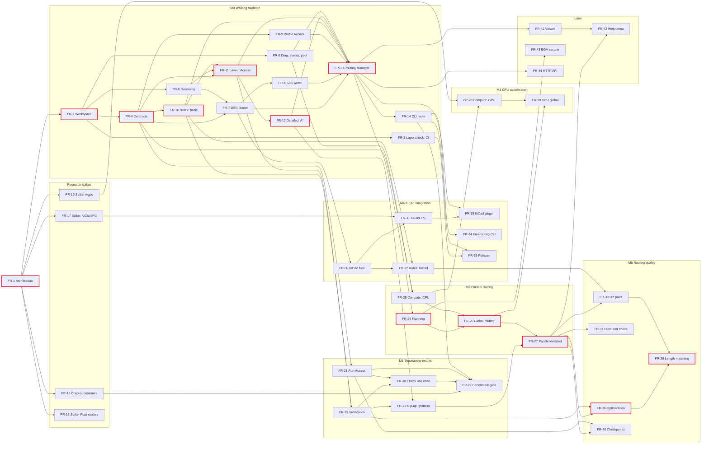

# Project plan

The plan follows the project design half of the iDesign Method: one activity per component, built in the order of the dependencies between them, with integration points where a use case first runs end to end. The activities are the tasks on the board; each has an `estimate` in ideal developer days, the iDesign `layer` it builds and the tasks it depends on.

[TOC]

## Milestones

Epics are milestones: `tasks/<milestone>/FR-n.md`.

| Milestone | Integration point: done when | Effort (days) |
| --- | --- | --- |
| **M0 Walking skeleton** | A simple 2-layer board routes from DSN to SES on the command line and imports into KiCad (UC1, sequential) | 38.5 |
| **Research spikes** | The corpus and Freerouting baselines exist; wgpu and the KiCad IPC API are proven or ruled out | 7.5 |
| **M1 Trustworthy results** | Every result is verified independently; the corpus runs in CI against Freerouting; the keyboard routes completely (UC5, UC6) | 20 |
| **M2 Parallel routing** | Global routing plus parallel detailed routing on every core, with identical results on any thread count | 18 |
| **M3 GPU acceleration** | Global routing kernels on the GPU where the benchmark shows a gain, identical results to the CPU | 13 |
| **M4 KiCad integration** | Route from `.kicad_pcb` headless and inside KiCad with undo; Freerouting's CLI accepted; release binaries for six targets (UC2, UC3) | 20.5 |
| **M5 Routing quality** | Optimisation, push and shove, differential pairs, length matching; corpus completion and DRC-clean rate above Freerouting's (UC4) | 28 |
| Later | Viewer, web demo, BGA escape, HTTP API (UC7) | 17 |

Total: about **165 developer days** including [[FR-1]].

## Dependency network

The critical path is drawn bold red.

## Critical path

With enough developers, the longest chain decides the end date:

[[FR-1]] → [[FR-2]] → [[FR-4]] → [[FR-10]] → [[FR-11]] → [[FR-12]] → [[FR-13]] → [[FR-24]] → [[FR-26]] → [[FR-27]] → [[FR-36]] → [[FR-39]]: **49 days**.

- Contracts, rules, Layout Access and the first detailed router are the spine: everything waits for them. Put the strongest developer on the critical path and keep it free of other work.
- M4 (KiCad) hangs off the DSN reader, not off the router, so a second developer can start it around day 7: plugin and files are ready by day ~27.
- The research spikes need only [[FR-1]] and can start at once; the benchmark corpus ([[FR-15]]) must be ready before M1 closes.

## Staffing

| Team | Duration (estimate) | Assignment |
| --- | --- | --- |
| 1 developer | ~165 days | Milestones in order, spikes first |
| 2 developers | ~85 days | A: critical path (contracts, rules, layout, engines). B: utilities, Board Access, spikes, CLI, then M4 |
| 3 developers | ~60 days | As two, plus C: Verification, Run Access, benchmark (M1), then GPU (M3) |

Estimates are ideal days; add the usual margin for integration and review. Re-plan after M0, once the walking skeleton has measured the real cost of the spine.
